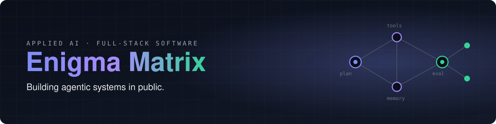

<p align="center">
  
</p>

<p align="center">
  <b>AI and software, built to run in production.</b><br>
  Agents · Retrieval (RAG) systems · Full-stack products
</p>

---

### 🧭 What this is

This account is the workshop behind **Enigma Matrix**. It's where the code lives, where experiments start, and where the agentic systems get built **in public**: designs, failures, evaluations and all.

### 🤖 Building in public: agentic systems

The goal is agents that do real work and can show they did it right, not just demos.

| Track | What it explores | Status |
| --- | --- | --- |
| **Agent runtime** | Planning, tool use, memory and recovery from failure | 🟡 Designing |
| **Evaluation first** | Every agent ships with an eval set and regression tests | 🟡 Designing |
| **RAG that holds up** | Retrieval you can measure, with citations you can check | 🟢 Prototyping |
| **Agent-assisted engineering** | Building whole products with AI coding agents, with tests and CI as the guard rails | 🟢 In daily use |

Progress, write-ups and code will land here as each piece becomes usable.

### 🧩 Products in the Matrix

| | Product | What it does | Status |
| --- | --- | --- | --- |
| 🛒 | **Matrix Mart** | A local marketplace: free listings, in-app chat without sharing your number, nearby skilled workers | Built |
| 📄 | **Enigma Tools** | PDF tools that run entirely in the browser. Your file is never uploaded | In development |
| 🎓 | **Enigma Campus** | Build-along tracks that rebuild a real AI system, one commit at a time | In development |
| 🎲 | **Enigma Games** | Ludo and Connect Four against a computer that plans ahead (negamax + alpha-beta, in a Web Worker) | Playable |

### 📐 How things get built here

```text
scope ─► prototype on real data ─► production build ─► hand over
           │                          │
           └─ checked against an      └─ tests · CI on every change · docs
              evaluation set
```

Stack-agnostic by design: the right tool for the problem, picked per project.

---

<p align="center"><sub>Enigma Matrix · building in the open</sub></p>
