  

### 👋 About me

I'm a software engineer who builds things end to end, from the system underneath to the interface on top. I don't tie myself to one stack: I pick up whatever the problem needs and ship it to production with tests, CI and documentation.

I work AI-first. Coding agents like **Claude Code** are part of how I design, build, review and ship software every day, and I know how to get production-quality results out of them rather than demos.

### ⚡ What I can do

- **🤖 AI agents & LLM apps:** agents with tool use and memory, retrieval (RAG) pipelines, and evaluation sets that prove they work
- **🧠 Agentic engineering:** building and maintaining whole codebases with AI coding agents, with tests and CI as the guard rails
- **🌐 Full-stack products:** web apps from database and APIs to a polished, responsive UI, on any stack
- **☁️ Shipping & operations:** containers, CI/CD pipelines and cloud deployments
- **👁️ Machine learning:** computer vision and applied ML, from training models to deploying them
- **⚙️ Systems fundamentals:** operating systems, networking and low-level programming, so I understand what runs underneath

### 🎯 What's next

Building **agentic systems in public**: agents that do real work and can show they did it right. The code, experiments and lessons will show up here as they become usable.
